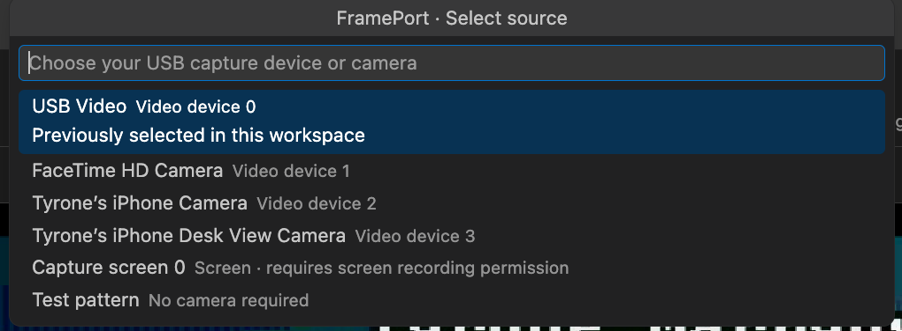

# Other video sources

FramePort does not need to be limited to HDMI capture cards. The source picker can also show cameras and screen sources exposed by macOS.

*USB video, the FaceTime camera, the iPhone camera, Desk View, a screen source, and the test pattern. The list is whatever macOS exposes.*

The iPhone camera is the phone's camera on the Mac, so the preview is you. Desk View is the overhead camera from the same phone. Both appear because macOS presents them as video devices, the same way it presents a capture card.

Seeing the iPhone's own screen, the way a simulator does, is a different source. Those two camera entries are not that. Sending a picture back to the phone would need a receiving application, and that path is not this one. Sources come into FramePort.
